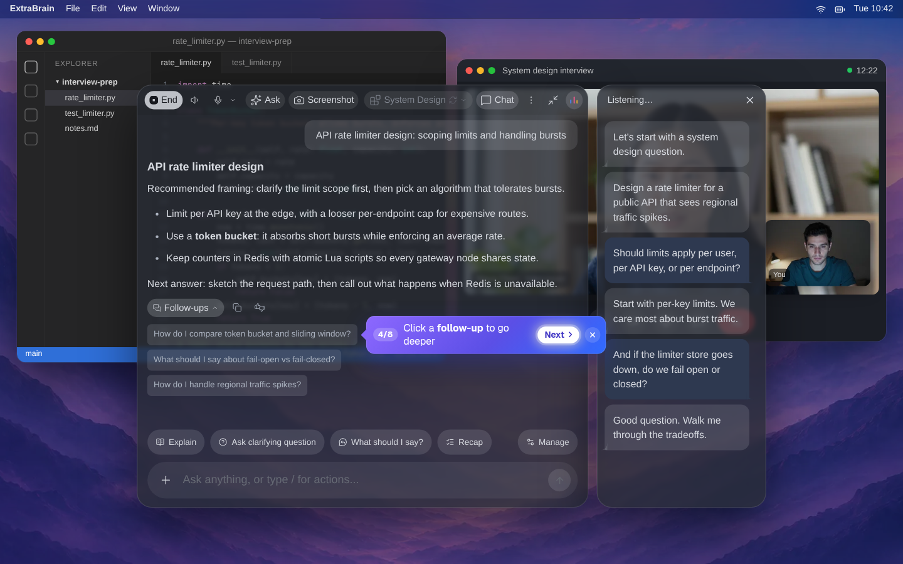
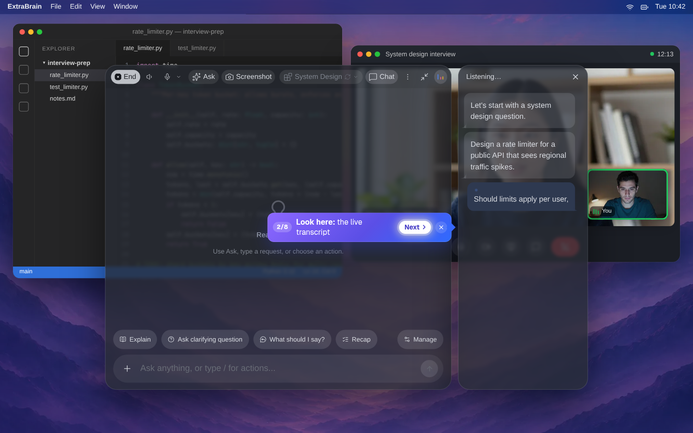
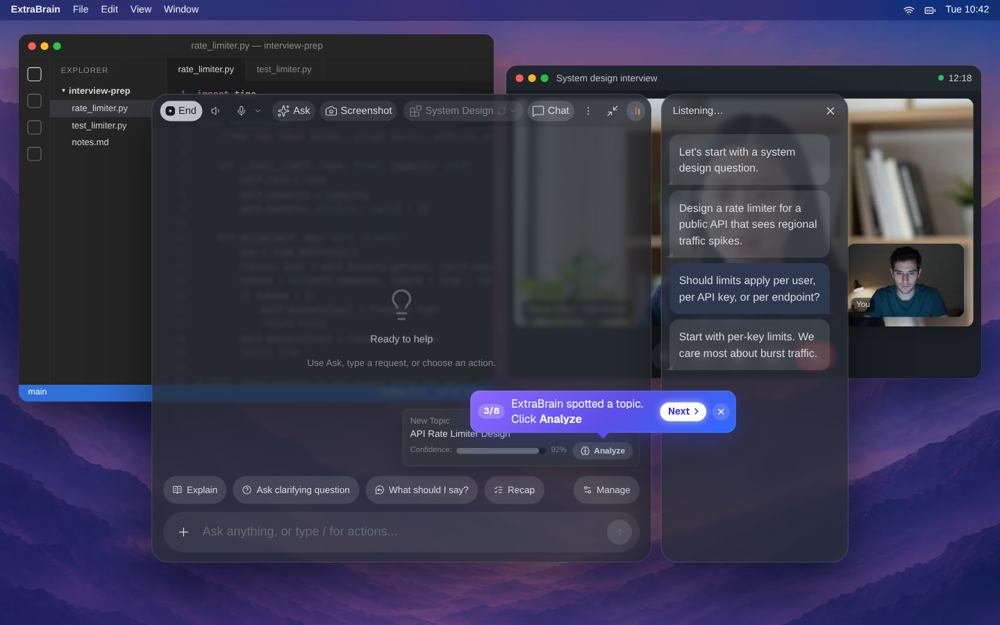
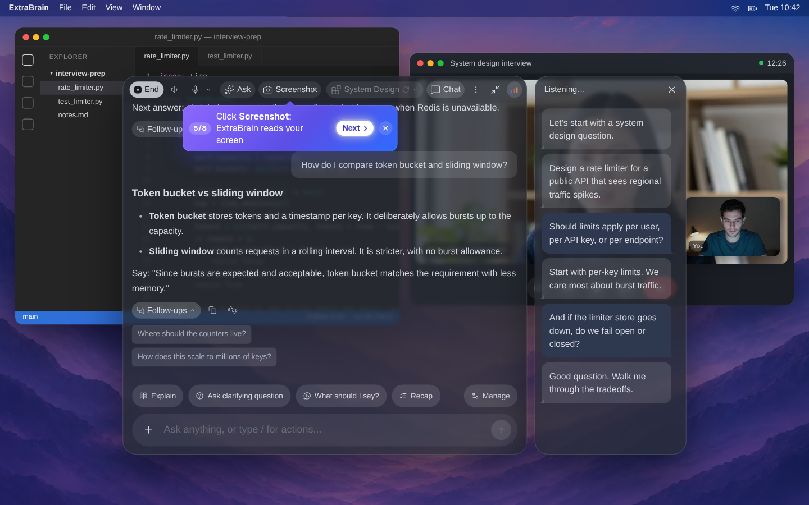
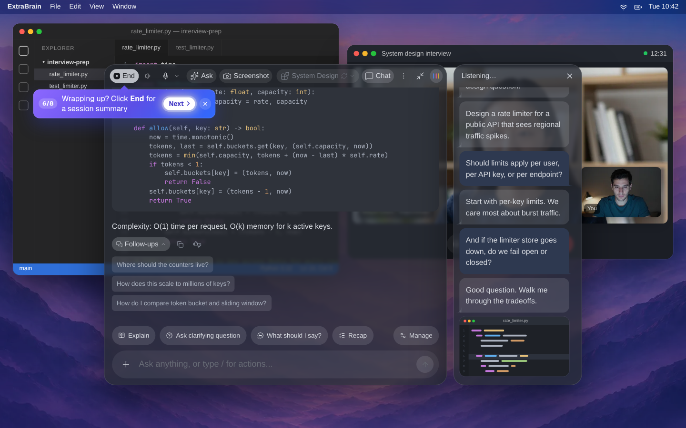
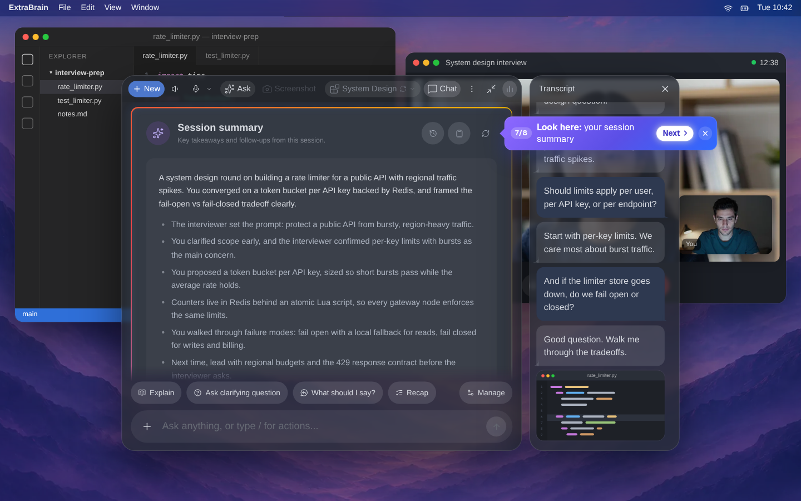

# ExtraBrain: free AI interview copilot for Mac and Windows

ExtraBrain is a free, local-first desktop app that follows live interviews and meetings. It transcribes the conversation, reads what's on your screen, and helps you structure answers for coding, system design, and behavioral rounds. Afterward you get a session history to review.

This repository hosts the official ExtraBrain releases. The website and Help Center live at [extrabrain.app](https://extrabrain.app/?utm_source=github&utm_medium=repo&utm_campaign=releases).

## Download

| Platform | Get it |
|---|---|
| **Mac** (macOS 14+, Apple Silicon and Intel) | [Latest release (.dmg)](https://github.com/ExtraBrainApp/ExtraBrain-releases/releases/latest) · [Mac App Store](https://apps.apple.com/us/app/extrabrain-app/id6795829980?mt=12) |
| **Windows** | [Microsoft Store](https://apps.microsoft.com/detail/9NTMNV341MK2?cid=github-releases) · [Latest release (.exe)](https://github.com/ExtraBrainApp/ExtraBrain-releases/releases/latest) |

Linux is planned.

## What it does

- **Live transcription**, either local (NVIDIA Parakeet, on your machine) or Deepgram.
- **Screen-aware context**: it follows the code, prompts, docs, or whiteboard you're looking at.
- **Answers you can structure**: clarifying questions, STAR outlines, tradeoffs, and follow-ups for coding, system design, and behavioral rounds.
- **Your choice of AI**: on-device Gemma, your own OpenAI, Anthropic, Claude, Codex, or compatible endpoint, or ExtraBrain AI credits.
- **No meeting bot**: it runs on your computer and never joins Zoom, Teams, or Meet as a participant.
- **Session history and summaries** to review what was asked and what to prepare next.

## Screenshots

| | |
|---|---|
|  |  |
| **Live transcript** that follows the call | **Topic detection** with one-click analysis |
|  |  |
| **Screen context** for prompts, code, and docs | **Code and tradeoffs** for technical rounds |
|  | |
| **Session summary** to review afterward | |

## Pricing

The core app is free. Pro is $9.99/month or $79/year. The $29 Job Search Pass covers 90 days, and Lifetime is $149. There's a 14-day trial with no card. [Compare plans](https://extrabrain.app/pricing/?utm_source=github&utm_medium=repo&utm_campaign=releases).

## Privacy

With local transcription and on-device Gemma, transcripts and prompts can stay on your computer. Content goes to an external provider only when you choose one. See [Data flow](https://extrabrain.app/data-flow/).

## Responsible use

Use ExtraBrain only where the interview, employer, school, meeting, and platform rules allow AI assistance, transcription, or notes. Many people use it for practice, mock interviews, and post-interview review. [Responsible use](https://extrabrain.app/responsible-use/).

## Help and feedback

- [Help Center](https://extrabrain.app/help/)
- [Discord community](https://discord.gg/KQM7kC65w)
- Bugs and feature requests: [info@extrabrain.app](mailto:info@extrabrain.app)
